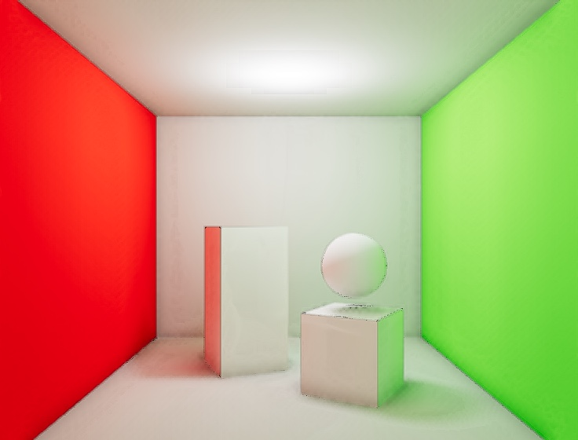

# @pmndrs/gi

[](https://www.npmjs.com/package/@pmndrs/gi) [](https://pmndrs.github.io/gi/) [](LICENSE)

**Real-time global illumination for WebGPU.** Light bounces around your scene and keeps up as lights, objects and the sun move. An engine-free GI platform carries the techniques; the first is Dynamic Diffuse Global Illumination (DDGI): a grid of probes that trace rays every frame. Plain WebGPU and WGSL underneath, with a three.js adapter on top.

**▶ [Examples](https://pmndrs.github.io/gi/)**: small pages, each showing one feature. (The site goes live once the `pmndrs/gi` repository is public and its Pages site is on; until then the examples run from a checkout, see [Working on this repository](#working-on-this-repository).)



**Status:** a working prototype, not published yet. Light bounces in real time through a grid of probes, and follows moving lights, objects and the sun, textured materials, several probe volumes and one that follows the camera. Quality presets for slower GPUs, saved bakes and an export to three's `LightProbeGrid` are in. What's in the first release, and what isn't checked yet, is in [CHANGELOG.md](CHANGELOG.md).

## Install

```bash
npm install @pmndrs/gi three
```

One package, an import path per layer:

| Import | For | Needs |
| --- | --- | --- |
| `@pmndrs/gi/three` (or `@pmndrs/gi`) | three.js `WebGPURenderer`, with DDGI's `DDGIVolume` and `ddgi()` composite | `three` r187 (`~0.187.0`) |
| `@pmndrs/gi/core` | The GI platform on your own `GPUDevice`: the scene, rays, light and sky that techniques build on, for plain WebGPU or an adapter for another engine | nothing: three isn't needed |
| `@pmndrs/gi/ddgi` | The DDGI technique, engine-free, run on the platform from `/core` | nothing: three isn't needed |

`three` is an optional peer dependency, so a project that only imports `/core` and `/ddgi` doesn't install it. With TypeScript, add `@webgpu/types` for the WebGPU types.

## Getting started with three.js

GI takes the place of three's `LightProbeGrid`, in as many lines. You give it a box and a number of probes; `start` copies your scene, warms the probes up, and from then on GI updates itself inside `renderer.render`:

```ts
import * as THREE from 'three/webgpu';
import { createGIRenderer, DDGIVolume } from '@pmndrs/gi/three';

const { renderer } = await createGIRenderer(); // a WebGPURenderer on a device with the limits GI needs
renderer.setSize(innerWidth, innerHeight);
document.body.appendChild(renderer.domElement);

const scene = new THREE.Scene(); // your meshes, materials and lights, as usual
const camera = new THREE.PerspectiveCamera(50, innerWidth / innerHeight, 0.1, 100);

const volume = new DDGIVolume(6, 5, 6, 6, 6, 6); // like new LightProbeGrid(6, 5, 6, 6, 6, 6): a 6 × 5 × 6 m box, 6 probes a side
volume.position.set(0, 2.5, 0);
scene.add(volume);
await volume.start(renderer, scene); // like probes.bake(renderer, scene)

renderer.setAnimationLoop(() => renderer.render(scene, camera)); // no per-frame GI call
```

What's different from `LightProbeGrid`:

- **It keeps updating.** Move a light, open a door or turn the sun, and GI follows within a few frames. `bake` is a one-off.
- **It knows about walls.** Each probe keeps how far it can see in every direction, so light leaks far less through walls between probes, and probes inside walls switch themselves off.
- **`createGIRenderer`** makes three's renderer on a GPU device with the adapter's full limits. three's own device caps a storage buffer at WebGPU's default, 128 MiB, which large scenes (Sponza, Bistro) outgrow. If you make the renderer yourself, pass it `requiredLimits(adapter)` from `@pmndrs/gi/core`.
- **One word sets the quality** for slower GPUs: `await volume.start(renderer, scene, { preset: 'low' })`.

Where to go next:

- [The examples](https://pmndrs.github.io/gi/) ([source](examples/)): the code above on three's own probe-grid scene (`01-hello`), GI added once per pixel on three's post-processing pipeline (`02-composite`), and one small page for each feature.
- [docs/api/three.md](docs/api/three.md): the three.js adapter, every option, and what it does with your scene.
- [docs/guides/adapter.md](docs/guides/adapter.md): GI from plain WebGPU, or an adapter for another engine, step by step through [examples/webgpu/hello/](examples/webgpu/hello/).
- [docs/api/platform.md](docs/api/platform.md): the engine-free API, `@pmndrs/gi/core` and `@pmndrs/gi/ddgi`.

The examples run from this repository: `pnpm install`, then `pnpm examples`. The viewer (`pnpm dev`) shows every test scene with GI, its debug views and its settings.

## Split Radiance Cascades experiment

Import `NativeRadianceCascades` from `@pmndrs/gi/radiance-cascades` for the engine-independent WebGPU solver. Its WGSL passes own the probe cache and produce linear diffuse irradiance. Run `pnpm examples` and open `/11-radiance-cascades/` to compare it with the Three.js reference on the same rail, close a moving shutter, or try temporal upscaling. [Project spec](docs/radiance-cascades/SPEC.md) · [Implementation plan](docs/radiance-cascades/PLAN.md) · [Research](research/radiance-cascades/README.md)

## Browser support

GI runs on WebGPU only; there is no WebGL fallback.

- **Browsers with WebGPU:** Chrome and Edge 113 and later; Safari 26 and later (macOS, iOS and iPadOS).
- **Checked on:** the target devices, an RTX 3060 Laptop GPU (Windows, Chrome) and an Apple M5 Pro (macOS, Chrome), and the correctness device, an Intel UHD integrated GPU (Windows, Chrome). Safari, an iPad and an older iOS device haven't been run yet.
- **Slower GPUs:** pick a lower preset (`{ preset: 'low' }`), or let `recommendPreset` (from `@pmndrs/gi/ddgi`) pick one from the adapter.
- **Large scenes** need more GPU memory per buffer than WebGPU's defaults. `createGIRenderer` asks for the adapter's full limits; if you make the device yourself, pass it `requiredLimits(adapter)` from `@pmndrs/gi/core`.

## Documentation

- [Getting started with three.js](#getting-started-with-threejs), above.
- [The three.js adapter](docs/api/three.md): every option, and what it does with your scene.
- [The platform API](docs/api/platform.md): `@pmndrs/gi/core` and `@pmndrs/gi/ddgi` on a bare `GPUDevice`.
- [Writing an adapter](docs/guides/adapter.md): GI from plain WebGPU, or for another engine, step by step.
- [Examples](https://pmndrs.github.io/gi/).
- [CHANGELOG.md](CHANGELOG.md): what each release contains.
- [THIRD_PARTY.md](THIRD_PARTY.md): code from others and the test scenes, with their licences.

## Credits

Built by [Dennis Smolek](https://github.com/DennisSmolek), to be maintained under the [Poimandres](https://github.com/pmndrs) collective.

- **DDGI** is implemented from the published papers: Majercik, Guertin, Nowrouzezahrai and McGuire, ["Dynamic Diffuse Global Illumination with Ray-Traced Irradiance Fields"](https://jcgt.org/published/0008/02/01/) (JCGT, 2019), and Majercik, Marrs, Spjut and McGuire, ["Scaling Probe-Based Real-Time Dynamic Global Illumination for Production"](https://jcgt.org/published/0010/02/01/) (JCGT, 2021). NVIDIA's RTXGI-DDGI was the comparison it was checked against; none of its code is used.
- **Ray tracing** builds its trees with [tinybvh](https://github.com/jbikker/tinybvh) by Jacco Bikker (compiled to WebAssembly, and its H-PLOC builder ported to the GPU) and a GPU LBVH ported from AMD's [HIPRT](https://github.com/GPUOpen-LibrariesAndSDKs/HIPRT). Both MIT; their licence texts ship in the package.
- **[three.js](https://threejs.org)**: the adapter is shaped like its `LightProbeGrid`, and GI renders through its `WebGPURenderer` and TSL.
- **[@pmndrs/upscaler](https://github.com/pmndrs/upscaler)**: the sibling package this one's tooling and examples follow.

## License

MIT, see [LICENSE](LICENSE). The bundled tinybvh, Emscripten runtime and HIPRT code keep their own licences; the package's `THIRD_PARTY.md` lists them, with their texts in `licenses/`.

<!-- The npm package README ends here. Below: working on this repository. -->

## Working on this repository

```bash
pnpm install
pnpm dev             # the viewer: every test scene with GI, its debug views and settings
pnpm examples        # the examples site, at http://localhost:5203
pnpm lint && pnpm typecheck && pnpm test
pnpm build           # the package, into packages/ddgi/dist
pnpm verify:packed   # packs it and checks it as a user would get it
pnpm test:release    # runs the publish workflow's steps against throwaway repositories
pnpm test:gpu        # the GPU checks, in headless Chrome on a real GPU
```

The published package, `@pmndrs/gi`, is `packages/ddgi`; it bundles the private workspace packages `ddgi-core` (the engine-free platform, `/core`, and DDGI, `/ddgi`), `ddgi-three` (the three.js adapter) and `bvh`. The workspace folders and private names keep `ddgi` for now ([docs/DECISIONS.md](docs/DECISIONS.md), 2026-11-10). [docs/releasing.md](docs/releasing.md) says how a release is cut, and what CI checks and doesn't.

How the work is run:

- [SPEC.md](SPEC.md): what v1 is, how it's built, how we judge it, and the milestones.
- [PLAN.md](PLAN.md): build order, how agents work, and what "done" means for a task.
- [TASKS.md](TASKS.md) and [PROGRESS.md](PROGRESS.md): the live task board and the running log.
- [docs/milestones/](docs/milestones/): one note per milestone, with what works, its checks and its known misses.
- [CLAUDE.md](CLAUDE.md): orientation for agents; [docs/NOTES.md](docs/NOTES.md) and [docs/DECISIONS.md](docs/DECISIONS.md): learned facts and settled choices.
- [docs/AUDIT-2026-10-30.md](docs/AUDIT-2026-10-30.md): why this is a fresh start. It reviews the earlier experiment in [DennisSmolek/ddgi](https://github.com/DennisSmolek/ddgi).
- [research/](research/): background notes carried over from that experiment.
- `native/rtxgi-ddgi`: NVIDIA's RTXGI-DDGI test harness (a fork), used only as an external comparison and timing tool. Its code is not part of this library.
