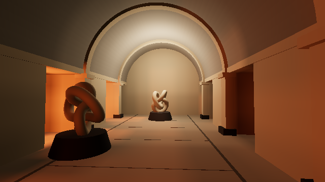
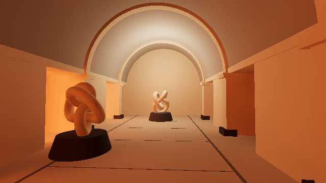
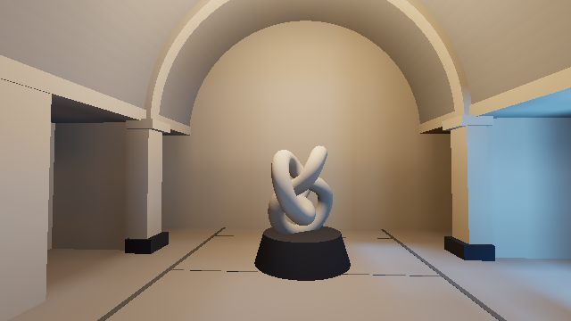
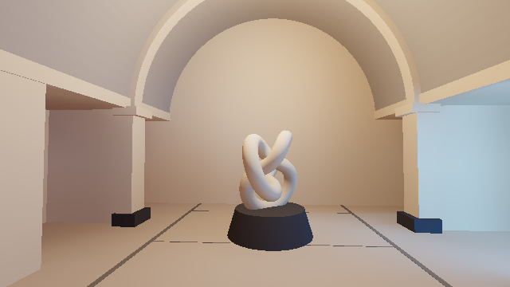
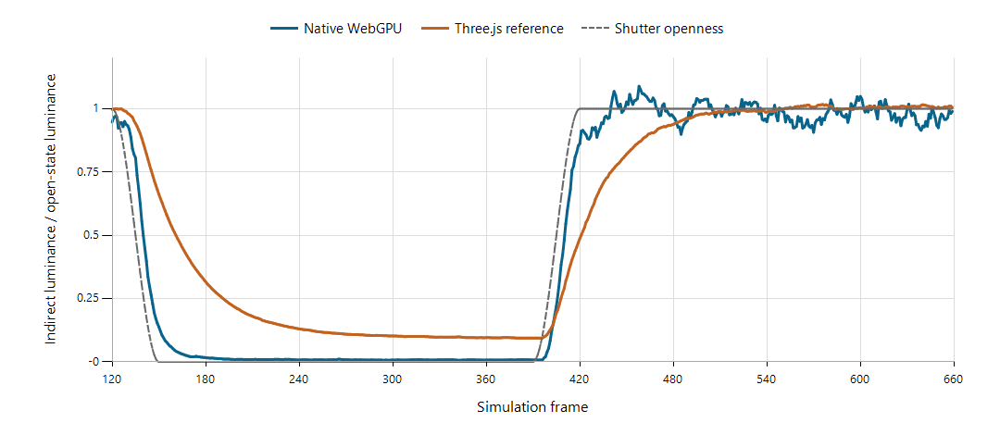

# Split Radiance Cascades in GI

## Question

How much diffuse light survives a reduced ray budget when the camera uncovers a room or an emitter changes? A still image of Sponza hides two costs that matter in an interactive renderer: filling newly visible probes and retiring old light. The architectural rail repeats those events at the same poses and lighting cues.

The fixed receiver below has a dim direct lamp at the far end of the passage and blue emitters recessed beside the sculpture. Both captures use the same camera, cue, and exposure. The composite reveals the blue spill on the sculpture.

| Direct lighting | Direct and indirect lighting |
| --- | --- |
|  |  |

## Native solver

The `@pmndrs/gi/radiance-cascades` entry takes a WebGPU device, a bounded world-space volume, two surface textures and an interval transport. GI owns the probes and their persistent directional history. The caller owns the device, command encoder and queue submission. With the pathtracer transport, submit each frame before encoding the next so its per-frame uniform ring can be reused. [Core implementation](../../packages/ddgi-core/src/techniques/radiance-cascades/native.ts)

The solver launches one ray per stride-sized screen tile. Before the hit, a directional bin receives evidence of transmittance. The interval containing the hit receives outgoing radiance. The ray contributes no observation beyond the hit. A miss samples the environment in the last interval. The near, middle and far grids halve their dimensions at each step and store 24, 96 and 384 directional bins per cell. The solver accumulates observations, merges far to near using transmittance and gathers diffuse irradiance at each visible surface. The prototype uses dense bounded grids, three levels, one containing parent per merge, and a six-axis diffuse projection with trilinear spatial gather. Radiance is clamped to 64 per channel during accumulation. Bins expire after 120 unobserved ticks. [WGSL passes](../../packages/ddgi-core/src/techniques/radiance-cascades/shaders.ts)

```ts
import { NativeRadianceCascades, createRcTransport } from '@pmndrs/gi/radiance-cascades';

const transport = await createRcTransport(device, sceneData);
const rc = await NativeRadianceCascades.create(device, {
    bounds: { min: [-4, 0, -4], max: [4, 4, 4] },
    grid: [16, 8, 16], firstInterval: 0.5, maxDistance: 12, rayStride: 2,
});
rc.resize(width, height);
// Same-size GPUTextureViews. Position.w > 0 marks a surface.
// Normals are signed world-space unit vectors. Update instance transforms before encode.
const encoder = device.createCommandEncoder();
rc.encode(encoder, { worldPosition, worldNormal }, transport);
device.queue.submit([encoder.finish()]);
// Sample rc.outputTexture (linear rgba16float). Reflected radiance = albedo * E / pi.
// Call rc.dispose() and transport.dispose() when the scene is released.
```

The gallery uses Three.js to rasterize direct light, surface attributes and depth, and optionally to reconstruct a reduced-resolution image. The native transport calls the pathtracer's closest-hit and visibility queues for opaque emissive or Lambertian surfaces with point lights. A custom transport only needs to implement `beginFrame` and `encode`. [Transport](../../packages/ddgi-core/src/techniques/radiance-cascades/transport.ts) · [Gallery adapter](../../examples/11-radiance-cascades/native-adapter.ts)

## Rough reflections

Set `roughSpecular: true` when creating the native solver. Supply perceptual roughness in the world-normal texture's alpha channel. The optional `specular` input to `encode` accepts a 16-byte uniform buffer containing a world-space camera position (w = 1) or an orthographic surface-to-camera direction (w = 0), plus an optional same-size `rgba16float` storage view. If the caller omits the output view, sample `rc.specularTexture` after encoding. Omitting the specular input skips the gather for that frame.

The query returns prefiltered incident radiance in RGB. The output adapter applies the material's specular reflectance. The broad lobe uses the merged directional field. At lower roughness a nine-direction cone reads the nearer and farther intervals and composes them using observed transmittance. The finite cone and the near cascade's 24 directions limit the detail available on polished surfaces. The gather reuses the rays already traced for diffuse lighting. [WGSL implementation](../../packages/ddgi-core/src/techniques/radiance-cascades/specular.ts) · [Analytical GPU fixture](../../tools/gpu/pages/rc-native-reflections/)

The polished gallery uses the original rail and lighting cues. The floor-strip example varies roughness under shared lighting. The reflection-motion example keeps the receiver camera fixed while a colored emitter moves above the viewport. [Experiment list and references](../../research/radiance-cascades/reflections.md)

## Reference and dynamic geometry

The Three.js reference descends from Chandra via zalo's Three.js PR and the S5 upscaler example. Both solvers share camera, geometry, cues and exposure. The reference includes a secondary bounce. The native transport shades the closest hit with emission and shadowed direct illumination. The A/B compares end-to-end techniques at a matched primary stride. [Research and original implementations](../../research/radiance-cascades/README.md)

The matched rail captures below use 640 × 360, native presentation, one primary ray per 2 × 2 tile and the same camera and emitter sequence. The direct-only images matched pixel for pixel. Both solvers picked up the color change; the native indirect image was darker on both poses.

| Rail tick | Native WebGPU | Three.js reference |
| --- | --- | --- |
| 183 · amber |  |  |
| 359 · blue |  |  |

The recessed lamp stays on as the shutter travels for 30 ticks each way. The native transport retains static geometry and updates the shutter instance. The reference refits its BVH and retains probe history. The test measures a fixed receiver patch in scene-linear indirect light before exposure, tone mapping or temporal reconstruction. [Door and timeline](../../examples/11-radiance-cascades/door-scene.ts) · [Response test](../../tools/gpu/pages/rc-door-response/main.ts)



Each trace uses its own open-state median. The native open receiver measured 0.135 linear luminance and the Three.js receiver measured 0.282. A separate CPU integration of the emitter’s single diffuse bounce gives 0.170 with the shutter open and zero with it closed. At 320 × 180 and stride 2, native retained 0.79% and Three.js retained 9.53% after closure. T90 after the end of closing travel was 2 frames for native and 58 for Three.js. After reopening it was 12 and 49 frames. The test requires eight consecutive samples past a threshold. [Per-frame measurements](../../bench/results/radiance-cascades-shutter.csv)

## Reference hit scratch memory

The reference port allocates two four-component vectors for every G-buffer pixel, including pixels that launch no ray. The gallery reference stores that position and normal once per dispatched ray lane. Secondary gather and trace consume the previous frame's lanes before primary trace overwrites them. The previous frame's grid and width recover its pixel seed. A new allocation invalidates secondary history for that frame, and partial cells clear their lane even if the sampled pixel lies outside the viewport.

Capacity grows to `ceil(1.25 × requiredRayLanes)` when needed. Probe tables, G-buffer textures and hit scratch are separate allocations. The paired test reports probe and scratch bytes individually and the resize test exercises both partial cells and capacity reuse.

## Transport boundary

The [interval experiment](../../experiments/rc-intervals/) checks the low-level tracer endpoint contract. The native depositor puts a hit exactly on an internal split into the next interval. The analytical GPU test covers an exact split, constant sky, a near occluder and a near/far directional mixture. [Core GPU test](../../tools/gpu/pages/rc-native-core/)

The pathtracer's experimental neural radiance cache estimates outgoing radiance and adds training, history and memory costs. Consider it for secondary radiance when a visible lighting deficit justifies the additional training and GPU budget. A reduced G-buffer with depth and motion vectors can feed the upscaler. Report whether probe spacing uses display or render pixels. Consider the downsampler when a measured pass actually needs a depth pyramid.

## Acceptance

- A locked install serves the demo without downloading a model. Direct, indirect and composite views show the same pose and lighting event. A real WebGPU run verifies indirect light on a receiver and response to changed emission.
- Record GPU, browser, drawing size, stride, probe budget, history state and timing scope. Separate cascade compute from full frame time. A speedup requires paired runs with corresponding image evidence.
- Check an interval seam, a miss, and the distinction between transparent and unobserved intervals on the GPU. Verify hit distance and lighting on known geometry. Judge changes to the web renderer by measured frame cost, retained detail, leakage and settling on the moving rail and shutter. Differences from Chandra or S5 can help locate an artifact.
- The moving-geometry gate is the sliding-shutter chamber. Every ray and raster pass must see the same transform. Both solvers must attenuate indirect light on closure and restore it after reopening.

See [the plan](PLAN.md) for implementation order and [PROGRESS](../../PROGRESS.md) for verified results.
