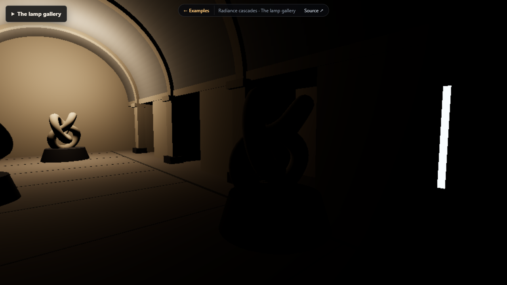
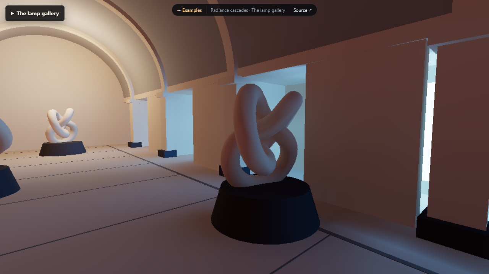

# Split Radiance Cascades in GI

## Question

How much diffuse light survives a reduced ray budget when the camera uncovers a room or an emitter changes? A still image of Sponza hides two costs that matter in an interactive renderer: filling newly visible probes and retiring old light. The architectural rail repeats those events at the same poses and lighting cues.

The fixed receiver below has a dim direct lamp at the far end of the passage and blue emitters recessed beside the sculpture. Both captures use the same camera, cue, and exposure. The composite reveals the blue spill on the sculpture.

| Direct lighting | Direct and indirect lighting |
| --- | --- |
|  |  |

## Deliverables

- [Architectural rail](../../examples/11-radiance-cascades/) in the examples gallery. Geometry and emitters are generated locally. The Three.js reference solver descends from Chandra via zalo's Three.js PR and upscaler S5. This branch targets opaque diffuse materials, static triangles, moving cameras and changes to existing emitters.
- [GPU interval experiment](../../experiments/rc-intervals/) for the pathtracer's closest-hit interface. The reference rail uses the S5 triangle traversal while the experiment exercises the shared tracer separately.
- [Research collection](../../research/radiance-cascades/README.md) covering the manuscripts, Chandra, the Three.js lineage, other 3D implementations and proposed comparisons.

## Renderer contract

1. Rasterize direct color, albedo, normals and depth. Reconstruct visible world positions. A world-space grid identifies probes across camera motion.
2. Allocate visible probe cells and the parents needed for interpolation. Bound storage up front. Hold spacing, capacity, LOD policy and exposure fixed for paired captures.
3. Trace from visible surfaces. A hit contributes radiance and opacity to the first interval whose upper end contains its distance. Nearer intervals receive evidence of transparency. Farther intervals remain unobserved by this ray. A miss can transmit through all tested intervals to the boundary lighting.
4. Accumulate directional evidence in the probe tables and merge far to near. With foreground radiance and transmittance `(L, T)`, composition is `Lnear + Tnear * Lfar`. Gather over directions against the receiver normal and apply diffuse albedo once when compositing.
5. Retain probe history across the rail. Pause freezes the scene and probe history for comparing lighting views. The fixed receiver camera lets GI settle at one pose while the simulation runs. Replay starts with the same pose, lighting and history initialization.

## Hit scratch memory

The reference port allocates two four-component vectors for every G-buffer pixel, including pixels that launch no ray. The GI version stores that position and normal once per dispatched ray lane. Secondary gather and trace consume the previous frame's lanes before primary trace overwrites them. The previous frame's grid and width recover its pixel seed. A new allocation invalidates secondary history for that frame, and partial cells clear their lane even if the sampled pixel lies outside the viewport.

Capacity grows to `ceil(1.25 × requiredRayLanes)` when needed. Probe tables, G-buffer textures and hit scratch are separate allocations. The paired test reports probe and scratch bytes individually and the resize test exercises both partial cells and capacity reuse.

## Transport boundary

The engine-independent solver will own allocation, direction sampling, deposition, merging, invalidation and irradiance. The tracer owns intersection and may shade hits. For `RtIntervalTracer` the surface-ray buffer supplies the interval, the distance result classifies the hit and a negative result indicates a miss. Use the open-low, closed-high convention. The binary visibility traversal has different endpoint behavior in the referenced revision.

The pathtracer's experimental neural radiance cache estimates outgoing radiance and adds training, history and memory costs. It is a candidate for secondary radiance once first-bounce transport agrees. A reduced G-buffer with depth and motion vectors can feed the upscaler. Report whether probe spacing uses display or render pixels. Consider the downsampler when a measured pass actually needs a depth pyramid.

## Acceptance

- A locked install serves the demo without downloading a model. Direct, indirect and composite views show the same pose and lighting event. A real WebGPU run verifies indirect light on a receiver and response to changed emission.
- Record GPU, browser, drawing size, stride, probe budget, history state and timing scope. Separate cascade compute from full frame time. A speedup requires paired runs with corresponding image evidence.
- Check an interval seam, a miss, and the distinction between transparent and unobserved intervals on the GPU. Require equivalent hits and lighting on the rail before comparing the shared-tracer solver's speed.
- The first moving-geometry gate is the existing closed-door fixture. Primary, secondary and shadow traversal must see the same door transform as rasterization.

See [the plan](PLAN.md) for implementation order and [PROGRESS](../../PROGRESS.md) for verified results.
