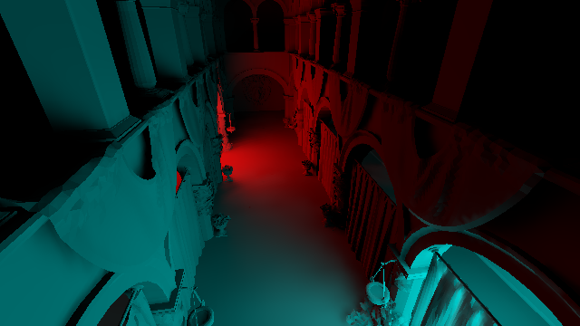
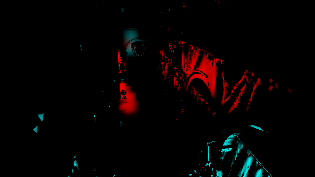

# Chandra on Windows

The reference is the authors’ Rust implementation of Split Radiance Cascades. It uses LuisaCompute’s CUDA and OptiX backend. The GI project’s S5 example is a separate Three.js port. [Chandra source at `9af00e8`](https://github.com/entropylost/chandra/tree/9af00e8de135a4126cb137d1ec62b451bd6b8e37)

## Measured reference

The original ran 128 updates on an NVIDIA GeForce RTX 3060 Laptop GPU (6 GiB), driver 592.00. The clean-shell run used only the staged binaries and operating-system paths. All 1,382,400 radiance components across the two images were finite. The reported split/deposit count was 237,506 at frames 1, 33, 65, 97 and 128. The GPU started at 77°C, so this capture supplies image evidence only. [Original float images and mask, ZIP](../../bench/results/chandra-sponza-linear.zip) · [Capture metadata and SHA-256 hashes](../../bench/results/chandra-sponza-reference.json)

| Original diffuse | Original reflected-direction output |
| --- | --- |
|  |  |

The primary visibility classes contain 226,329 ordinary surface pixels, 68 red-emitter pixels and 4,003 cyan-emitter pixels. All 230,400 pixels hit geometry. The paired WebGPU capture matched the red and cyan labels on all 4,071 pixels in the union of the two emitter masks. [Paired comparison implementation](../../tools/gpu/pages/rc-chandra/main.ts) · [Lighting comparison measurements](../../PROGRESS.md)

## Reproduce the matched capture

The Windows build uses an NVIDIA GPU, its installed driver, Visual Studio 2022 with the x64 C++ build tools and CMake ≥3.26, Git, curl, tar and a rustup executable. The script places the Rust nightly, CUDA development libraries, source checkouts and build products beneath `$Root`. NVIDIA’s SHA-256 manifest verifies the CUDA 12.4.1 archives. The source pins are Chandra `9af00e8de135a4126cb137d1ec62b451bd6b8e37`, Sefirot `571a9461897b7c8d52df0caa1d533d6c5e44ad9c` and LuisaCompute’s Rust binding `374e0b3d2e936f56ec93ad1a9021911b010ecb74` from Chandra’s original Cargo.lock. [Bootstrap script](../../tools/reference/chandra/build.ps1)

```powershell
# Run in the GI worktree from an x64 PowerShell process.
$root = Join-Path $env:TEMP 'gi-chandra-reference'
& ./tools/reference/chandra/build.ps1 -Root $root
& ./tools/reference/chandra/run.ps1 -BuildRoot $root
node tools/reference/bench-lock.ts run --what rc-sponza --no-cool-wait -- node tools/gpu/run.ts --gpu nvidia --filter rc-chandra --out bench/screenshots/rc-chandra --json bench/screenshots/rc-chandra.json
```

To trace a difference, set `VITE_RC_CHANDRA_DUMP=1` before the browser test. The run JSON then carries the WebGPU diffuse image and the primary world position and normal. `node tools/gpu/pages/rc-chandra/analyze.ts <run.json> <reference-dir>` splits the difference by pixel class, normal, emitter distance, probe-cell position and screen tile, and writes ratio maps. `VITE_RC_CHANDRA_GRID`, `_FIRST_INTERVAL`, `_MAX_DISTANCE`, `_HISTORY`, `_NORMAL_BIAS`, `_STRIDE` and `_FRAMES` each change one native solver setting. `VITE_RC_CHANDRA_NATIVE_ONLY=1` skips the Three.js arm. The 2026-11-26 sweep found that probe spacing drives both the mean and the local differences. [Findings](../../PROGRESS.md)

The browser test compares scene-linear diffuse radiance and the primary visibility mask. Its WebGPU reflection uses roughness 0.15 and is sampled before Fresnel weighting. Chandra samples one reflected direction through its original cascades.

On the measured Windows workstation the built runtime lives in `bench/screenshots/chandra-local/`. From the GI worktree, run `./tools/reference/chandra/run.ps1` to regenerate the reference or `./tools/reference/chandra/run.ps1 -Interactive` to open the original 1920×1080 Chandra viewer on the emitter-only Sponza scene. The launcher supplies the executable directory on PATH, uses the local runtime as the working directory, and acquires the shared GPU lock. The interactive launch uses a copy of the Sponza configuration under the filename the binary loads. Its default display adds visible emission to diffuse lighting and applies the upstream AgX transform. In a clean-shell smoke test, the unmodified executable opened the Chandra window, initialized its 353 MB Sponza cache, and closed after the readiness check. `G` cycles between diffuse, reflected, and combined display. The fixed capture sets `GI_CHANDRA_ROOT`, `GI_CHANDRA_LINEAR`, `GI_CHANDRA_PRIMARY`, and `GI_CHANDRA_SPECULAR` in the invoking PowerShell process for the paired browser fixture. [Launcher](../../tools/reference/chandra/run.ps1)

The interactive executable loads `scenes/sanmiguel_alt.json` inside `main()`. That scene references external assets. The upstream `render` binary parses arguments and loads a scene, then returns before it dispatches rendering work. Our headless driver invokes the original probe allocation, ray generation, interval splitting, merging and optimized 32-direction shading functions in the order used by the interactive program’s default single-bounce mode. A final GPU readback writes the requested channels. [Headless driver](../../tools/reference/chandra/capture.rs) · [Author’s frame loop](https://github.com/entropylost/chandra/blob/9af00e8de135a4126cb137d1ec62b451bd6b8e37/src/main.rs) · [Author’s render CLI](https://github.com/entropylost/chandra/blob/9af00e8de135a4126cb137d1ec62b451bd6b8e37/src/bin/render.rs)

## Shared input and output

| Parameter | Value |
| --- | --- |
| Geometry | Original bundled `assets/sponza.obj`, 381 named objects, 262,267 triangles after triangulation. SHA-256 of LF-normalized OBJ text is `ec7b65b793692db211e3011d71f8b02f3d3b57ec5c7da90e5805360ce44f452b`. |
| Author world coordinates | An OBJ vertex `(x,y,z)` becomes `(z,x,y)`. Positive world Z is up. |
| Camera | Position `[-94.45221, -937.2442, 613.4341]`, forward `[0.13625954, 0.87882446, -0.45727552]`, right `[0.98819260,-0.15321680,0]`. Vertical FOV is 1.15 radians. |
| Lighting | Uniform diffuse albedo 0.7. The authored red emitter is instance 1 (`sponza_328`), cyan is instance 9 (`sponza_322`). Chandra multiplies their authored emission by diffuse albedo, giving outgoing RGB `[7,0,0]` and `[0,4.9,4.9]`. A generated black environment and zero sunlight isolate these emitters for the cross-engine comparison. |
| Solve | Fixed camera, 640×360 pixels, 128 updates, ticks 0–127, four original cascades, base grid size 6 and base probe capacity 131,072. Single-bounce mode. |
| Linear files | `diffuse.rgb32f` and `specular.rgb32f` each contain 2,764,800 bytes. Each pixel contains three little-endian IEEE 754 floats, tightly packed, top row first. Diffuse is gathered incoming diffuse multiplied by receiver albedo. Specular evaluates the reflected view direction in the four original cascades. Both channels exclude directly visible emission and give zero for primary misses. |
| Alignment file | `primary.u8` contains 230,400 bytes, one per pixel. Values 0, 1, 2 and 3 represent miss, regular surface, red emitter and cyan emitter. Compare this before assigning an image difference to either solver. |
| PNG previews | The driver maps each linear channel through `x/(1+x)` followed by sRGB encoding. The float images are the inputs for numerical comparisons. |

The matching camera comes from the authors’ Sponza configuration and the Sefirot camera’s ray formula. The checked-in author example also uses sunlight and an external dusk EXR. That lighting differs from the emitter-only comparison above. [Sponza configuration](https://github.com/entropylost/chandra/blob/9af00e8de135a4126cb137d1ec62b451bd6b8e37/scenes/sponza.json) · [Camera source](https://github.com/entropylost/sefirot/blob/571a9461897b7c8d52df0caa1d533d6c5e44ad9c/yesod/src/camera.rs)

## Windows build details

LuisaCompute C++ revision `cbeea79a7f611ac417b988c23993af05cd789cbb` passes the optional compiler scheduling flag `-split-compile=0` to NVIDIA’s standalone shader compiler. Windows NVRTC 12.4 rejected this flag with `llc: Unknown command line argument '-split-compile=0'`. The bootstrap recompiles the standalone helper from its pinned C++ source, removing that flag from its argument list and using binary mode for its input and output pipes. Geometry traversal, the generated CUDA shader source, and Chandra’s RC algorithm are the original implementations. The helper links the NVRTC libraries statically and the staged backend uses the installed NVIDIA driver. [Windows helper build](../../tools/reference/chandra/build-nvrtc.ps1) · [Upstream CUDA backend](https://github.com/LuisaGroup/LuisaCompute/tree/cbeea79a7f611ac417b988c23993af05cd789cbb/src/backends/cuda)

The interactive main initializes its DDGI comparison after allocating the RC irradiance texture. The DDGI initialization commits pending bindless texture registrations. The headless driver calls the same bindless update directly before its first kernel dispatch.
