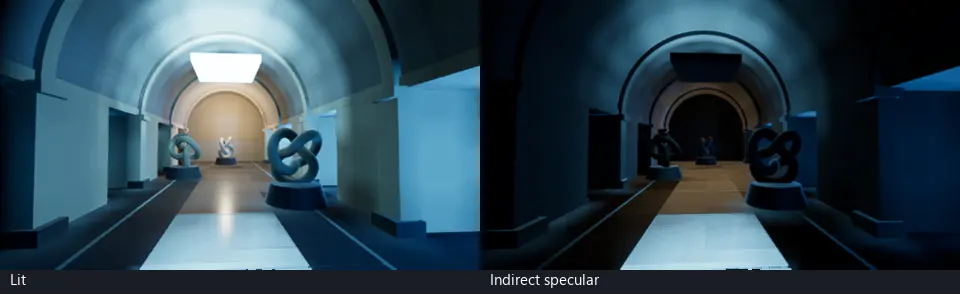
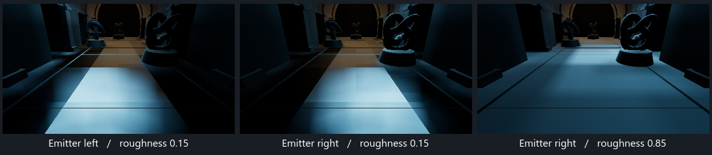

# Radiance cascade experiments

| Experiment | What to try | What to look for |
| --- | --- | --- |
| Polished gallery rail | Follow the lamp gallery with indirect specular on, then repeat with it off. Inspect the reflection-only view. | The floor reflection follows camera motion. Turning the gather off removes it while direct lighting stays fixed. |
| Floor roughness sweep | Compare strips of the same floor material at different roughnesses under one emitter. | Higher roughness spreads the highlight. The lowest roughness shows the angular resolution available from the cache. |
| Offscreen emitter | Fix the camera and move the emitter above the viewport. | Reflected energy shifts across the floor even while the emitter stays outside the image. |
| Upstream diffuse comparison | Use Chandra's Sponza geometry and camera, hold emission constant and compare linear indirect radiance. | A shared scene exposes brightness and spatial interpolation differences. Sun, sky, frame count and capture units must match. |
| Sharp reflection rays | Future experiment. Trace a specular BVH ray for smooth surfaces and sample RC lighting at the hit. Sweep the transition to the rough gather. | Check narrow features and motion stability, and measure the extra rays and GPU time. |

## Gallery

The recording follows the original gallery rail. The lit and reflection-only views each accumulate their own temporal history at 1.5× reconstruction.

The fixed-camera example below holds exposure constant. The first two captures move the lamp with the same floor finish. The third increases floor roughness with the lamp fixed.

## Sources

Sannikov describes querying radiance in a cone centered on the reflected view vector. The cone angle depends on material roughness. Probes keep their directional information until the diffuse projection. [Original manuscript](https://github.com/Raikiri/RadianceCascadesPaper/blob/main/RadianceCascades.tex)

Freeman and Sannikov focus on diffuse GI in Split RC and discuss rough specular as an extension. Their Chandra implementation includes an optional specular view. It reflects the view direction, queries cascade 3 and composes the three nearer intervals using their directional transmittance. This gives us a concrete directional query to compare with the roughness-dependent WebGPU gather. [Pinned upstream shader](https://github.com/entropylost/chandra/blob/9af00e8de135a4126cb137d1ec62b451bd6b8e37/src/main.rs#L149-L164) [Paper](https://arxiv.org/abs/2607.20384) · [Chandra](https://github.com/entropylost/chandra)

On September 21, Cody Bennett described single-bounce glossy GI obtained by reading cascade data with a split-sum approximation and no additional rays. On November 6 he showed a world-space example lit by emissive surfaces and the sky. Our offscreen-emitter example tests that first property with a finite-cone gather and a material Fresnel term. His separate classic RC repository provides a Three.js example. [Author's posts](https://teapawt.org/CodyBennett) · [three-rc](https://github.com/CodyJasonBennett/three-rc)

The independent Rust/Sokol Split RC project documents an opt-in rough-specular experiment. Its browser version documents a diffuse production path. [Rust/Sokol notes](https://github.com/wroughtinator/split-radiance-cascades-webgpu/blob/main/native/README.md) · [Browser notes](https://github.com/wroughtinator/split-radiance-cascades-webgpu)
